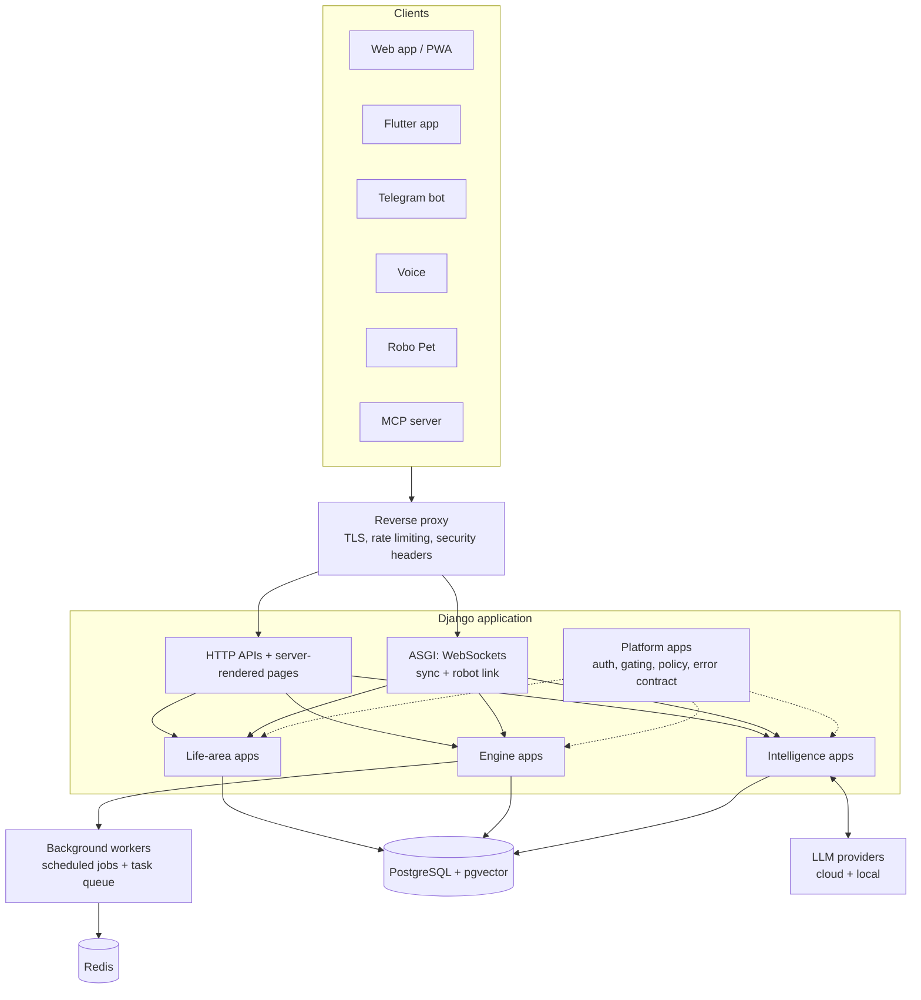
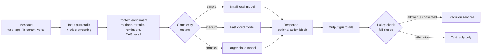
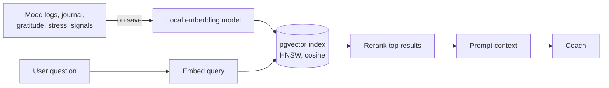

# Trifini architecture (public overview)

A high-level view of how Trifini is put together. Internals, configuration and operational details are intentionally omitted.

## Components

The backend is a modular Django monolith of ~38 apps in four layers sharing one database and one event bus:

1. **Life-area apps** hold domain data: finance, health, mood, routines, work, learning, career, relationships, environment, spirituality, legacy, balance, focus.
2. **Engine apps** act on that data: automation, scheduling, execution, reminders, proposals, calendar, gamification, social.
3. **Intelligence apps** reason over it: AI chat, RAG, agent loop, observations, memory, patterns, voice, experiments.
4. **Platform apps** are cross-cutting: users and subscriptions, policy, dashboard, sync, QA tooling, robot link.

A monolith was chosen deliberately: one data model makes cross-domain intelligence ("your sleep predicts your spending") a join, not an integration project.

## Cross-cutting design rules

- **Event bus.** Every user-facing action emits an observation that the intelligence layer consumes.
- **Uniform error contract.** One JSON error envelope across all modules, so every client handles errors the same way.
- **Two kinds of gating.** Feature flags act as kill switches; subscription gating controls plan entitlements.
- **Canonical write paths.** The UI and the AI funnel into the same service functions, so behaviour is identical regardless of who initiated an action.
- **Resilience.** Retries and circuit breakers wrap external calls.

## AI pipeline

- A **provider factory** abstracts the model vendor. Providers can be swapped by configuration, with a fully local path available.
- **Complexity routing** sends easy requests to cheap models and hard ones to stronger models, controlling cost and latency.
- **Model-agnostic fallbacks** keep core flows working even when a model returns unstructured text.
- The model never writes to the database directly. It proposes; the policy engine and execution services decide.

## RAG (personal memory)

Saving a supported record automatically embeds it. Retrieval is per-user and versioned by embedding model so the index can be rebuilt safely. A weekly job writes reflective summaries back into memory.

## Automation engine

User rules, schedules and AI suggestions converge on the same pipeline:

1. **Observe** - signals and events are collected passively.
2. **Propose** - rules or the AI draft a proposed action.
3. **Consent and policy** - the user's preferences and the policy engine approve or reject.
4. **Execute** - a shared execution service performs the action and records a change log.
5. **Notify** - results are delivered on the user's preferred channel.

Scheduled work (reminders, check-ins, recurring transactions, price refreshes, weekly reports) runs on a job scheduler plus a task queue, with failure alerting.

## Real-time and sync

- WebSockets carry multi-device sync (CRDT merges) and the robot connection.
- Offline clients queue changes and reconcile on reconnect.

## Clients

- **Web:** server-rendered pages enhanced with a PWA shell.
- **Flutter:** one codebase for web and Android; providers mirror backend modules; offline-first logging.
- **Telegram:** conversational interface and reminder buttons.
- **MCP server:** exposes a small set of tools so external AI agents can work with a user's data under that user's permissions.

## Quality machinery

- Automated tests across unit, API, browser end-to-end and mobile layers
- A compliance matrix that scores each engineering rule against each module
- CI and pre-push gates (types, lint, leak scanning, coverage, audits)
- Performance and accessibility audits
- An in-app QA hub with scheduled self-checks
- A team of AI agents under human approval handles routine engineering and operations work
