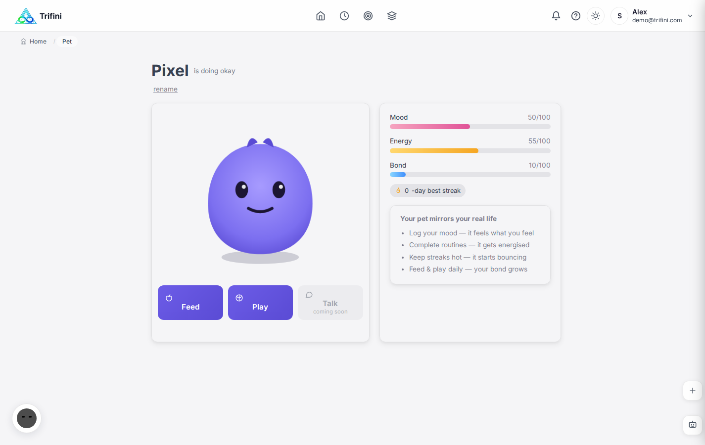

# Robo Pet

Trifini is more than a screen. The Robo Pet is a companion that lives wherever you are, built so that the product feels like a relationship, not a dashboard.

One companion, three forms:

| Form | What it is |
|---|---|
| **Virtual pet** | A living character on web and mobile |
| **Floating widget** | A small companion bubble on every page and, on Android, over other apps |
| **Physical robot** | A desk companion with a display, expressions and voice, built around an ESP32-S3 |

## The virtual pet

The pet is **a mirror of your real life**, not a game you have to feed to keep alive.

- **Mood** follows how you have been feeling (from your recent mood logs).
- **Energy** follows how you slept and how much you have completed today.
- **Bond** grows with care: feeding, playing and keeping up routines.
- It **bounces** when you hold a streak and gets **droopy or sleepy** when things slip, a gentle nudge rather than a guilt trip.
- With no data yet, the pet starts neutral instead of sad.
- Interactions have sensible cooldowns, and naming the pet passes through the same crisis-safety screening as every other text input.

### Companion behaviours

- 26+ shared expressions across virtual and physical forms
- Configurable proactivity: passive (only when tapped), semi-proactive (important events), or active (periodic encouragement)
- Idle life: breathing, blinking, small activities of its own
- Notifications can arrive "from" the companion with personality
- Multilingual voice, with a user-chosen name

## The physical robot

A compact desk companion that brings the coach into the room.

- **Hardware:** ESP32-S3 platform with a round display, speaker, microphone and servos; modular plug-in connectors so parts can be swapped without soldering
- **Design:** custom enclosure and PCB work, bill of materials and assembly documentation
- **Firmware:** PlatformIO project with an expression engine and 100+ planned behaviours
- **Connectivity:** an authenticated WebSocket link to the Trifini backend; the robot receives expressions and speech, and reports events
- **Experience:** users do not configure it manually; the robot handles it and expresses what the coach notices

The physical robot is in development. The virtual pet and widget are what users can try today.

## Why a companion

A coach that lives in a chat tab is easy to forget. A character that visibly reacts to your week is not. The companion makes progress and balance visible at a glance and gives people a reason to open the app that is not obligation.
